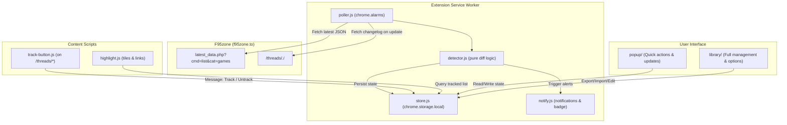

# Architecture & Design Decisions (docs/ARCHITECTURE.md)

## System Overview
`f95-update-tracker` is a lightweight, zero-dependency Manifest V3 browser extension built with standard Vanilla JS ES modules.

---

## Architectural Decisions

### 1. JSON API over RSS for Polling
- **Decision**: Poll `https://f95zone.to/sam/latest_alpha/latest_data.php?cmd=list&cat=games` directly instead of parsing RSS XML.
- **Rationale**:
  - The JSON API delivers discrete fields: `thread_id` (integer), `version` (string), `title` (clean string), `ts` (unix epoch timestamp in seconds), and `prefixes`.
  - RSS bundles title, prefixes, and version into a single composite string requiring heuristic regex parsing.
  - JSON payload is more compact and supports configurable page depth (`page` and `rows` parameters).
  - Works without cookies/login while supporting authenticated user cookies seamlessly via `credentials: 'include'`.

### 2. Opaque Version Comparison
- **Decision**: Versions are treated as strictly opaque strings. Any distinct string change between `installedVersion` and `latestVersion` triggers an update event.
- **Rationale**: Game versions on F95zone use arbitrary developer formats (e.g., `v0.12.1a`, `Ch.3 Part 2`, `Ep. 1`, `0.85_Fix2`, `Final`). Semver parsers inevitably fail on non-standard version notations. String difference (`stored !== latest`) is completely resilient.

### 3. Rate Limiting, Jitter, Request Budget & Circuit Breaker
- **Decision**:
  - Poll interval: default 30 minutes with randomized ±5 minute jitter.
  - Page depth cap (`pageDepthCap`): default 3 pages (up to 90 items per poll cycle).
  - Daily request cap (`dailyRequestCap`): adjusted to **200 requests/day** (from 150).
- **Request Budget Math & Rationale**:
  - A 24-hour day yields 48 poll cycles (at 30-minute intervals).
  - **Steady-state**: When the browser remains open and no major gap exists, each poll cycle inspects page 1, notices items older than `lastPollTimestamp`, and stops immediately. This consumes exactly **1 request per poll**, or **48 requests/day**.
  - **Catch-up state**: If the browser was closed for hours (e.g. overnight), the poller pages deeper until items are older than `lastPollTimestamp`, up to `pageDepthCap` (3 pages). 3 to 4 catch-up events per day add ~12-16 requests.
  - **Changelog fetches**: Throttled to 1 request per detected version change. Assuming 5-10 game updates per day, this adds ~10 requests.
  - **Upper Bound Evaluation**: If forum activity or closure forced all 48 cycles to page to the maximum depth of 3, consumption would be:
    $$48 \text{ cycles} \times 3 \text{ pages} = 144 \text{ requests/day}$$
    A previous limit of 150 left only 6 requests of headroom, which could prematurely trigger the daily cap on active days with multiple changelogs and manual "check now" clicks.
  - **Conclusion**: Setting `dailyRequestCap = 200` guarantees adequate headroom for heavy days (144 paging + changelog fetches + manual checks) while enforcing a strict ceiling to protect both user accounts and forum infrastructure.
- **Circuit Breaker**:
  - Upon encountering HTTP 403, 429, or Cloudflare challenge pages, the circuit breaker immediately engages.
  - Exponential backoff is applied: 30m, 60m, 120m, 240m up to 24h (`consecutiveFailures`).
  - While active, all background polling and manual check requests are strictly halted, and both Popup and Library UIs display a paused state alert. No tight retries are ever attempted.

### 4. DOM Security: Strict `textContent` Rendering
- **Decision**: All forum-derived content (titles, versions, changelog snippets, notes, tags) is strictly inserted via `.textContent` or `document.createTextNode()`. `innerHTML` is never used.
- **Rationale**: Completely prevents Cross-Site Scripting (XSS) from malicious or corrupted forum thread content.

### 5. Content Script Isolation & Highlights
- **Decision**: Use a single `MutationObserver` in `highlight.js` with debounced processing to mark tracked games on dynamic forum pages and tiles without impacting page performance.
- **Styling**: All highlights and track buttons use isolated, scoped class names prefixed with `f95-ut-` and non-intrusive CSS.

### 6. Storage Model
- Backed by `chrome.storage.local`.
- Schema:
  - `games`: Map of `[threadId]: GameRecord`
  - `settings`: Object with `domain`, `pollMinutes`, `pageDepthCap`, `dailyRequestCap`, `lastPollTimestamp`, `requestCountToday`, `circuitBreakerUntil`.
