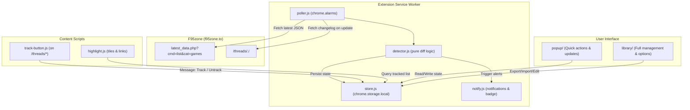

# Architecture & Design Decisions (docs/ARCHITECTURE.md)

## System Overview
`f95-update-tracker` is a lightweight, zero-dependency Manifest V3 browser extension built with standard Vanilla JS ES modules.

---

## Architectural Decisions

### 1. JSON API over RSS for Polling
- **Decision**: Poll `https://f95zone.to/sam/latest_alpha/latest_data.php?cmd=list&cat=games` directly instead of parsing RSS XML.
- **Rationale**:
  - The JSON API delivers discrete fields: `thread_id` (integer), `version` (string), `title` (clean string), `ts` (unix epoch timestamp in seconds), and `prefixes`.
  - RSS bundles title, prefixes, and version into a single composite string requiring heuristic regex parsing.
  - JSON payload is more compact and supports configurable page depth (`page` and `rows` parameters).
  - Works without cookies/login while supporting authenticated user cookies seamlessly via `credentials: 'include'`.

### 2. Opaque Version Comparison
- **Decision**: Versions are treated as strictly opaque strings. Any distinct string change between `installedVersion` and `latestVersion` triggers an update event.
- **Rationale**: Game versions on F95zone use arbitrary developer formats (e.g., `v0.12.1a`, `Ch.3 Part 2`, `Ep. 1`, `0.85_Fix2`, `Final`). Semver parsers inevitably fail on non-standard version notations. String difference (`stored !== latest`) is completely resilient.

### 3. Rate Limiting, Jitter & Circuit Breaker
- **Decision**:
  - Poll interval: default 30 minutes with randomized ±5 minute jitter.
  - Daily request cap: tracked in local storage; polling pauses if the cap is reached within a 24-hour sliding window.
  - Page depth cap: maximum 3 pages (or 90 items) per poll cycle.
  - Circuit Breaker: upon receiving HTTP 403, 429, or HTML challenge pages, trip the breaker with exponential backoff (e.g. 1 hour, 2 hours, 4 hours up to 24 hours), preventing spamming the forum.

### 4. DOM Security: Strict `textContent` Rendering
- **Decision**: All forum-derived content (titles, versions, changelog snippets, notes, tags) is strictly inserted via `.textContent` or `document.createTextNode()`. `innerHTML` is never used.
- **Rationale**: Completely prevents Cross-Site Scripting (XSS) from malicious or corrupted forum thread content.

### 5. Content Script Isolation & Highlights
- **Decision**: Use a single `MutationObserver` in `highlight.js` with debounced processing to mark tracked games on dynamic forum pages and tiles without impacting page performance.
- **Styling**: All highlights and track buttons use isolated, scoped class names prefixed with `f95-ut-` and non-intrusive CSS.

### 6. Storage Model
- Backed by `chrome.storage.local`.
- Schema:
  - `games`: Map of `[threadId]: GameRecord`
  - `settings`: Object with `domain`, `pollMinutes`, `pageDepthCap`, `dailyRequestCap`, `lastPollTimestamp`, `requestCountToday`, `circuitBreakerUntil`.
